<p align="center">
  <picture>
    <source media="(prefers-color-scheme: dark)" srcset="docs/assets/logo-dark.svg" />
    
  </picture>
</p>

<p align="center">
  A local-first AI memory system with a multi-agent backbone and a visual knowledge graph.
</p>


---

## What is Loom?

Loom is a personal knowledge system that stores everything as **plain Markdown** on your disk and uses a **team of AI agents** to keep it organized. Notes connect via `[[wikilinks]]`, and a **force-directed graph** lets you see your mind at a glance.

You write captures; agents do the structuring, linking, summarizing, and validating. The whole stack runs locally — your files, your provider keys, your machine.

> **New here?** The [Getting Started guide](docs/getting-started.md) walks you from install through onboarding, the main views, and the capture → note → graph loop.

## See Loom

<p align="center">
  
</p>

Loom 1.2 rebuilt the interface on [shadcn/ui](https://ui.shadcn.com): one app
shell, seven views and six themes, every one of them keyboard-reachable and
checked for WCAG AA contrast. These captures use the fictional demo vault.

<table>
  <tr>
    <td width="50%"></td>
    <td width="50%"></td>
  </tr>
  <tr>
    <td align="center"><sub><b>Notes</b>: edit Markdown with a lossless editor, properties and Spider's link suggestions</sub></td>
    <td align="center"><sub><b>Search</b> (⌘K): notes, actions and agents, with why each note matched</sub></td>
  </tr>
  <tr>
    <td></td>
    <td></td>
  </tr>
  <tr>
    <td align="center"><sub><b>Board</b>: agents, this week's numbers, undoable activity and the Council</sub></td>
    <td align="center"><sub><b>Inbox</b>: triage captures against Weaver's proposal and Sentinel's pre-check</sub></td>
  </tr>
  <tr>
    <td></td>
    <td>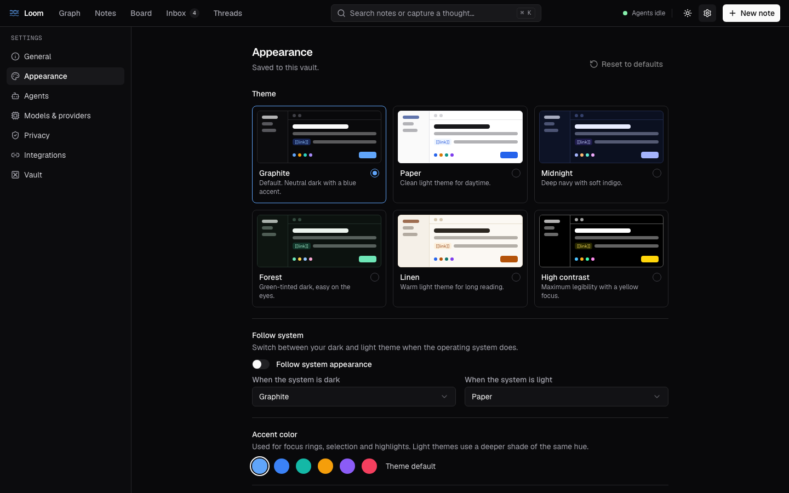</td>
  </tr>
  <tr>
    <td align="center"><sub><b>Threads</b>: daily logs, Standups and saved Council chats</sub></td>
    <td align="center"><sub><b>Settings</b>: six themes, accents, editor font and a colorblind graph palette</sub></td>
  </tr>
</table>

<table>
  <tr>
    <td width="33%">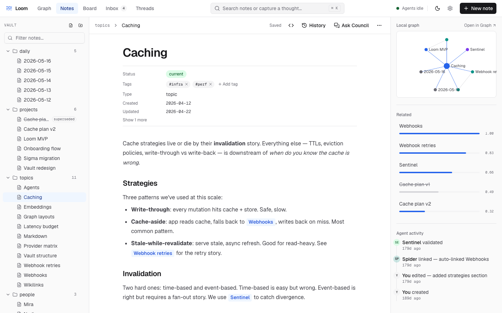</td>
    <td width="33%">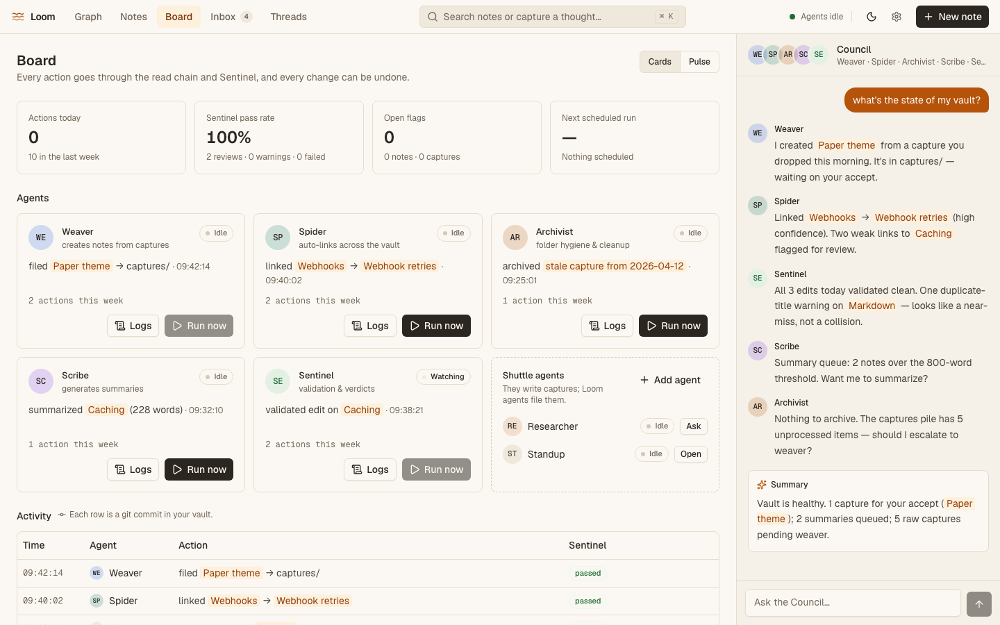</td>
    <td width="33%">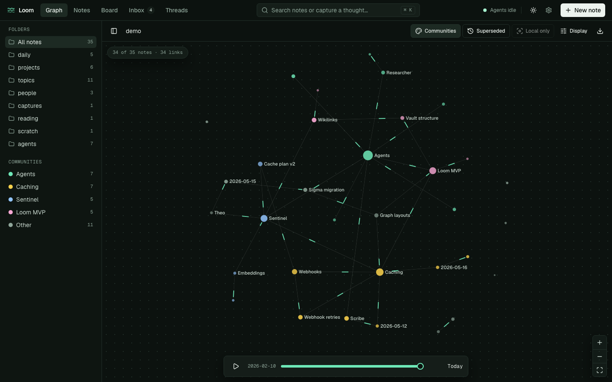</td>
  </tr>
  <tr>
    <td align="center"><sub>Paper</sub></td>
    <td align="center"><sub>Linen</sub></td>
    <td align="center"><sub>Forest</sub></td>
  </tr>
</table>

Every view in every theme is in [docs/screenshots](docs/screenshots/README.md).
The [30-second trailer](https://cdn.jsdelivr.net/gh/Mpawlowski5467/Loom@5e0c104fa46016db0710d550af86aac703e4bfcc/docs/trailer/loom-trailer.mp4)
shows the 1.1 interface.

## Why Loom?

- **Local-first.** Notes live as readable Markdown in `~/.loom/vaults/`. No lock-in, no cloud sync, no proprietary database.
- **Multi-agent, not single-prompt.** Seven specialized agents in two tiers (Loom Layer manages the vault; Shuttle Layer produces content) — plus any custom agents you add — collaborate via a shared *read-before-write* discipline.
- **Visual by default.** A `Sigma.js` + `graphology` canvas shows your notes as a living network, colored by the communities they form. Drag, zoom, scrub a timeline, or isolate a note's neighbors.
- **Provider-agnostic.** Connect OpenAI, Anthropic, Moonshot/Kimi, xAI, OpenRouter, Gemini, Groq, DeepSeek, Together, Mistral, or a local Ollama model. Chat and embedding providers are independent, and every model call is recorded as an inspectable trace.

## Architecture at a glance

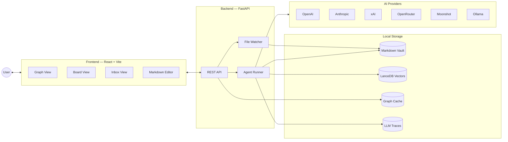

The backend reads and writes the vault on disk; the frontend renders it. The agent runner orchestrates AI calls; the file watcher keeps the index fresh when notes change outside the UI.

## The two-tier agent system

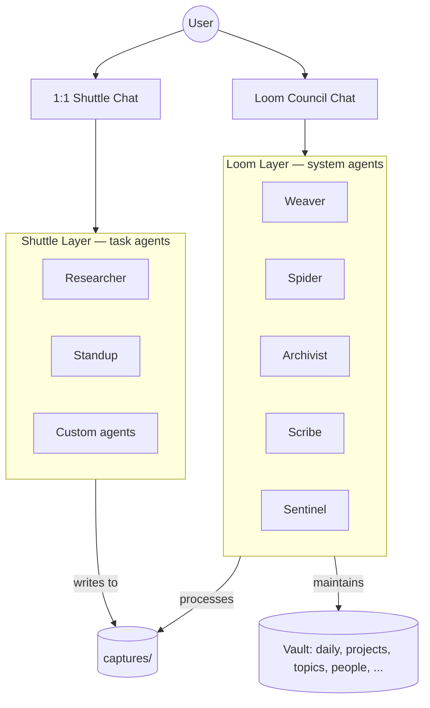

**Loom Layer** agents manage the vault. You speak to them collectively via the **Loom Council** — a transparent multi-agent thread where each one chimes in by role.

**Shuttle Layer** agents are task-driven; you chat with them one-on-one. They never write into the main vault — they drop output into `captures/`, and the Loom Layer takes it from there. You can also define your own custom Shuttle-tier agents from the Board; the seven built-ins below stay read-only.

### Agent reference

| Agent | Tier | Role |
|---|---|---|
| **Weaver** | Loom | Converts raw captures into structured notes with YAML frontmatter. |
| **Spider** | Loom | Finds semantic connections and maintains bidirectional `[[wikilinks]]`. |
| **Archivist** | Loom | Audits the vault — flags stale notes, broken links, missing metadata. |
| **Scribe** | Loom | Writes folder `_index.md` files and daily logs. |
| **Sentinel** | Loom | Validates every agent action against `prime.md` rules and schemas. |
| **Researcher** | Shuttle | Answers questions by searching the vault and citing source notes. |
| **Standup** | Shuttle | Generates scheduled daily recaps from vault activity and an optional read-only calendar feed. |

## Read-before-write

Every agent follows the same chain before performing any mutation. This keeps the vault internally consistent and gives `prime.md` (your constitution) real authority.

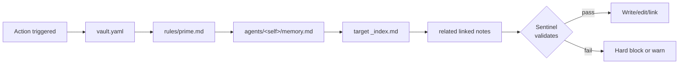

Hard block on failure by default; trusted agents can be configured for soft-warn.

## How it works

### From capture to note

A raw capture never becomes a note in one step. Weaver classifies and formats it, Sentinel validates the result against `prime.md` and the matching schema, the note is written to disk, and Spider connects it to the rest of the vault. The inbox lets you `preview` this whole chain as a dry run before you `commit`.

Capture producers all use one ingress service. Manual/API captures, Researcher,
Standup, custom agents, and Calendar receive the same provenance validation,
external-ID deduplication, indexing, durable job creation, and live-update events.
The Inbox exposes Active, Review, and History job views; queued work and terminal
outcomes survive restarts.

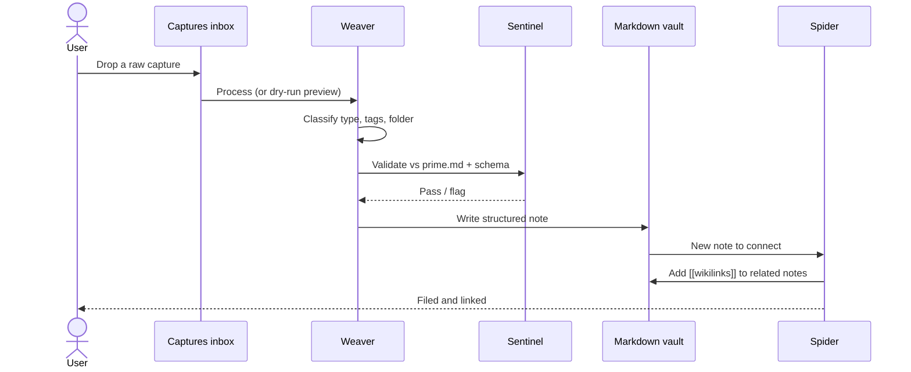

### Council chat, streamed

When you ask the Loom Council a question, the backend fans the prompt out to all five system agents (capped at three concurrent calls so a single turn doesn't blow a free model's rate limit). Each agent's take arrives as one `contributions` event, then an aggregator distils them into a single voice that streams back token by token over Server-Sent Events. The final `done` frame carries a `trace_id` so you can open the raw model call.

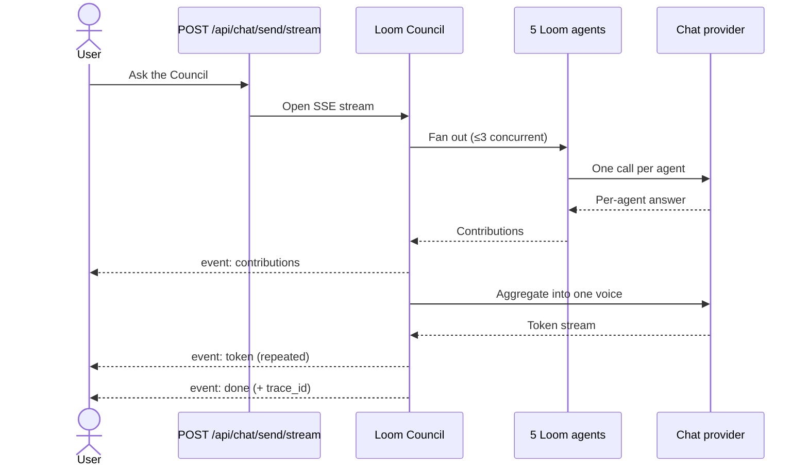

### Providers, and every call traced

All providers sit behind one registry. Chat and embedding providers are resolved independently, and every provider is wrapped in a `TracedProvider` that records each exchange — provider, model, messages, response, duration — into a 500-entry in-memory ring that also mirrors to disk by date. Each trace is also tagged with the `run` and `step` it belongs to, so a multi-step agent run (e.g. the capture pipeline: `weaver → spider → scribe → sentinel → enforce`) shows up as one connected run in the **Runs** view, not a scattered list of calls. The "raw call" link anywhere in the UI reads straight from `/api/traces`; the Runs view reads `/api/traces/runs`.

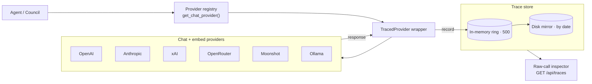

### Hybrid search

Search blends three signals: semantic similarity from LanceDB vectors, plain keyword matching with tag/type filters, and a graph-aware boost that lifts notes already linked to strong hits. When no embedding provider is configured, it degrades gracefully to keyword-only.

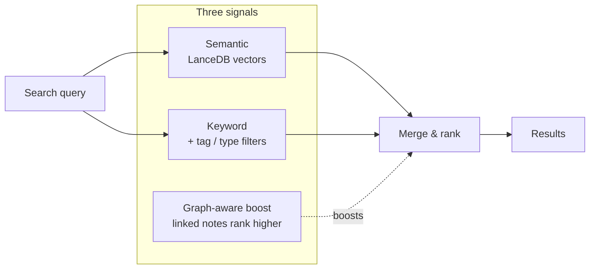

## Features

### Interface
- One app shell: Graph, Notes, Board, Inbox and Threads tabs, search, agent status, a light/dark toggle, Settings and **New note**
- Keyboard first: ⌘K search, `g` then `g`/`n`/`b`/`i`/`t` to switch views, ⌘N new note, ⌘⇧C quick capture, ⌘B to hide the sidebar
- Six themes (Graphite, Paper, Midnight, Forest, Linen, High contrast), optional follow-system with a theme per mode, accent colors, a serif editor font, a colorblind-safe graph palette, and text size, density and motion settings
- Every theme and accent passes WCAG AA contrast in a unit test, and a Playwright run screenshots every view in every theme with an axe check
- Built on shadcn/ui (Radix + Tailwind v4) with bundled Geist, Geist Mono and Newsreader fonts: nothing loads from a CDN at runtime
- Works down to phone width

### Knowledge graph
- Sigma.js 3 + graphology with drag, zoom and pan; a force layout plus five focus-first orbit scenes (rings, spiral, arms, galaxy, wave)
- Nodes colored by **community** (seeded Louvain over your links, named after each group's most-linked note); a legend doubles as a filter
- A creation-date **timeline** you can scrub or play, **Local only** to isolate a note's neighbors, and superseded notes hidden or shown
- Select a node to open the note beside the graph in a compact editor, with Archivist's warnings and its recent commits (each undoable)
- Structural changes are diffed into the live graph, so new notes settle in place without resetting the camera
- Export the view as PNG, SVG or JSON

### Vault & notes
- Multi-vault filesystem at `~/.loom/vaults/`
- Fixed core folders (`daily`, `projects`, `topics`, `people`, `captures`) plus your own
- Atomic Markdown writes with YAML frontmatter (`id`, `title`, `type`, `tags`, `created`, `modified`, `author`, `status`, `history`)
- A Plate rich-text editor that keeps Markdown the source of truth: unchanged blocks are written back byte for byte, so opening a note never rewrites it. A raw-Markdown mode sits beside it
- Properties, tags, inline `[[wikilink]]` chips with a picker, a slash menu, Spider's link suggestions, and a banner when a note is superseded
- A context rail with a local graph, related notes and agent activity; a History sheet with git-backed diffs and undo
- Durable drafts per vault and note, with explicit conflict compare, reload or overwrite
- Deletion = move to `.archive/`, never destroyed; a file watcher reflects external edits live

### Search
- Hybrid: semantic (LanceDB vectors) + keyword ranks fused with RRF, plus tag/type filters and graph-aware boosting
- The ⌘K palette groups notes, actions (capture, ask the Council, run Spider) and agents, filters by community, previews the selected note and explains why it matched
- Keyword fallback when no embedding provider is configured, and title/tag matching when the backend is unreachable

### Agents & chat
- Loom Council chat streams its answer token-by-token over SSE, with each agent's contribution shown as its own bubble
- Every model call is captured as a trace with provider, model, and latency; prompts and responses are included only when raw-content retention is enabled
- Custom agents: spin up your own Shuttle-tier agent from the Board; the seven built-in agents stay read-only
- Per-agent `memory.md` summarized every 20 actions
- Per-agent-per-day changelog at `.loom/changelog/<agent>/<date>.md`
- Chat history persisted as Markdown: `agents/_council/chat/` for Council, `agents/<name>/chat/` for Shuttle
- The Board shows actions today, Sentinel's pass rate, open flags and the next scheduled run; agent cards show Running/Idle/Scheduled/Watching and open each agent's instructions, runs and LLM calls
- Council replies end in a summary card; each agent's contribution expands from it
- Spider records deterministic link evidence with source excerpts and explicit suggested/applied/user-accepted states

### Daily workflow
- **Threads** collects Scribe's daily logs (with that day's new notes, flags and links), Standup recaps and saved Council chats, beside a week of agent activity and vault stats
- **Inbox** triage: Weaver's proposal (path, type, tags, community, links), a close-match merge, Sentinel's pre-check, and j/k/e/↵ keys
- **Quick Capture** is available from the shell shortcut and routes text or URLs through the same durable capture ingress as agents and connectors
- **Recoverable editing** keeps local drafts across navigation/reloads, compares conflicting edits, and offers revision restore plus conflict-checked undo of an AI run
- **Review with evidence** compares original/proposed text, suggests existing notes for an approved append/merge, and explains graph connections using recorded excerpts
- **Automation controls** pause background work, limit captures by source and estimated input tokens per day, show usage, and exclude folders/tags from cloud context
- **Source preservation** keeps original captures and bounded URL/PDF imports with extraction provenance; PDFs must contain extractable text (no OCR)

### Providers
- OpenAI (chat + embed)
- Anthropic (chat)
- xAI / Grok (chat)
- OpenRouter (chat — including `:free` models, with rate-limit-aware retries)
- Moonshot / Kimi (chat)
- Groq, DeepSeek, Together AI, Mistral, and Google Gemini (OpenAI-compatible chat; embeddings where supported)
- Ollama (local chat + embed)
- Chat and embedding providers configured independently

### Onboarding wizard
- First-run multi-step flow: Welcome → Vault Setup → Theme Picker → Provider Config
- Live previews of the six themes: Graphite, Paper, Midnight, Forest, Linen and High contrast
- Inline "Test connection" against the picked provider — **Finish** requires the selected chat and embedding providers to pass
- Skip-friendly: a confirmation path completes onboarding without a provider, leaving AI features offline until one is added
- Onboarding state lives in `~/.loom/config.yaml` under `onboarding.completed`

## Tech stack

| Layer | Tools |
|---|---|
| Backend | Python 3.12, FastAPI, Pydantic v2, Uvicorn |
| Agent orchestration | LangGraph (`StateGraph`) — the capture pipeline and Shuttle agents run as graphs over Loom's own providers (no LangChain provider stack) |
| Frontend | React 19, TypeScript 5.9, Vite, React Router |
| UI | shadcn/ui (Radix + Tailwind v4), cmdk, lucide-react, Sonner |
| Graph | Sigma.js 3 + graphology (force-atlas2 layout) |
| Editor | Plate with a lossless Markdown bridge, `react-markdown` previews, `[[wikilink]]` chips |
| Vector DB | LanceDB + PyArrow |
| AI | OpenAI / Anthropic SDKs, `httpx` for xAI / OpenRouter / Ollama |
| Realtime | Server-Sent Events (SSE) for streamed Council replies |
| File sync | `watchdog` |
| Rate limit | `slowapi` |
| Tests | `pytest` + `pytest-asyncio` (backend), `vitest` + Testing Library and Playwright + axe (frontend) |
| Lint/format | `ruff` (Python), ESLint + Prettier (TS) |

## Quick start

### Run with Docker (one command)

The fastest way to try Loom. Builds the frontend and backend into a single
container that serves both on **one port**.

```bash
cp .env.example .env     # optional — add a provider key, or skip and use onboarding
docker compose up        # first build takes a few minutes
```

Then open **http://localhost:8000**. The onboarding wizard handles vault and
provider setup on first run.

Your notes persist in the `loom-data` Docker volume across restarts and
rebuilds. To keep them as plain Markdown files on your machine instead, swap the
volume for a bind mount (see the commented line in `docker-compose.yml`).

`docker compose up` starts only the app container. The optional Redis
(response cache) and Postgres (trace mirror) services are opt-in: run
`docker compose --profile full up` and set `LOOM_REDIS_URL` /
`LOOM_DATABASE_URL` in `.env` (ready-made values are commented in
`.env.example`). Unset, both stay disabled and Loom is byte-identical without
them.

> **Note:** Provider API keys are encrypted at rest in `config.yaml`. By default,
> Fernet uses a machine-local key at `~/.loom/.secret.key`; source installs can
> install `.[keychain]` and set `LOOM_SECRET_STORAGE=keyring` to migrate that key
> into the OS credential store. `LOOM_SECRET_KEY` remains the deployment-managed
> override. This is defense-in-depth, not a substitute for API authentication.
>
> **Security:** the published port binds to `127.0.0.1` (this machine only) and the
> API ships **no auth**. Do not expose it to a LAN/internet without a reverse proxy
> + auth — see [SECURITY.md](SECURITY.md). An optional `LOOM_API_TOKEN` adds a
> shared-token speed bump for exposed ports, but it is **not** a substitute for that
> proxy — see [SECURITY.md](SECURITY.md#optional-api-token).

### Run from source (for development)

#### Prerequisites
- Python 3.12
- Node.js 22 with npm
- An API key for at least one provider (or a running Ollama instance)

#### Backend
```bash
cd backend
python3.12 -m venv .venv
source .venv/bin/activate
python -m pip install -r requirements.lock -r requirements-dev.lock
python -m pip install --no-deps -e ".[dev]"
python -m uvicorn api.main:app --reload --port 8000
```

On Windows, create the environment with `py -3.12 -m venv .venv` and activate
it with `.venv\Scripts\Activate.ps1`. Redis/Postgres clients are optional:
install `requirements-optional.lock` only when using those services.

#### Frontend
```bash
cd frontend
npm ci
npm run dev   # serves on http://localhost:5173
```

On first run the **onboarding wizard** walks you through vault name, theme, and provider setup. **Finish** is enabled after the selected chat and embedding providers pass their connection tests; **Skip for now** is a confirmed offline path. You can add a provider later from **Settings → Providers**. The backend reads `~/.loom/config.yaml` for global config and scaffolds a vault at `~/.loom/vaults/<name>` when the wizard completes.

### Seed an example vault
```bash
# Copy the demo vault to your local Loom directory
cp -r examples/demo-vault ~/.loom/vaults/demo
```

Then switch to it via `PUT /api/vaults/active` with `{"name": "demo"}` (or re-run the onboarding wizard with `demo` as the vault name).

## Configuration

Global config lives at `~/.loom/config.yaml`:

```yaml
active_vault: default
providers:
  default: openai
  openai:
    api_key: ${OPENAI_API_KEY}
    embed_model: text-embedding-3-small
    chat_model: gpt-4o
  anthropic:
    api_key: ${ANTHROPIC_API_KEY}
    chat_model: claude-sonnet-4-20250514
  xai:
    api_key: ${XAI_API_KEY}
    chat_model: grok-3
  openrouter:
    api_key: ${OPENROUTER_API_KEY}
    chat_model: qwen/qwen3-next-80b-a3b-instruct:free
  ollama:
    host: http://localhost:11434
    embed_model: nomic-embed-text
    chat_model: llama3
```

Per-vault config lives at `~/.loom/vaults/<name>/vault.yaml` (custom folders, agent overrides, etc).

## Project structure

```
Loom/
├── backend/
│   ├── api/              # FastAPI routers (notes, graph, search, chat, ...)
│   ├── agents/
│   │   ├── loom/         # Weaver, Spider, Archivist, Scribe, Sentinel
│   │   └── shuttle/      # Researcher, Standup
│   ├── core/             # vault, notes, config, watcher, providers, traces, exceptions
│   ├── index/            # LanceDB indexer, searcher, chunker
│   └── tests/
├── frontend/
│   ├── src/
│   │   ├── app/          # routes (URL model) and the route table
│   │   ├── views/        # GraphView, notes/, BoardView, InboxView, ThreadsView, SettingsView (+ a folder of parts each)
│   │   ├── components/   # ui/ (shadcn primitives), shell/ (header, layout), palette/, shared components
│   │   ├── onboarding/   # First-run wizard: Welcome, VaultSetup, ThemePicker, ProviderConfig
│   │   ├── theme/        # ThemeProvider, theme registry, appearance persistence, useThemeColors
│   │   ├── context/      # AppContext and its hooks (config, vault content, Council, polling)
│   │   ├── api/          # one typed client per resource; mocks/ for endpoints the backend lacks
│   │   ├── graph/        # Sigma setup, communities, layouts, live sync, drag physics
│   │   ├── editor/       # Plate editor + lossless Markdown bridge, react-markdown previews
│   │   └── styles/       # themes.css: every theme token
│   └── public/
├── docs/                 # architecture-ref.md, getting-started.md, style-guide.md, ui-backend-gaps.md, screenshots/, wireframes/
├── examples/
│   └── demo-vault/       # ready-to-use sample vault
├── scripts/              # seed and utility scripts
└── .github/workflows/    # CI
```

## API surface

The backend exposes a REST API on `:8000`. The most-used endpoints:

| Method | Endpoint | Purpose |
|---|---|---|
| `GET` | `/api/graph` | Fetch the force-directed graph (supports ETag caching) |
| `GET` | `/api/tree` | File tree |
| `GET` `POST` `PUT` `DELETE` | `/api/notes` | Note CRUD (delete = archive) |
| `GET` | `/api/search?q=...` | Hybrid search |
| `GET` `POST` | `/api/captures` | List & process captures (single or batch) |
| `GET` `POST` `DELETE` | `/api/captures/jobs` | Durable Inbox jobs, retry/cancel, and terminal-history retention |
| `GET` `PATCH` | `/api/automations/standup` | Daily Standup schedule and redacted Calendar connection state |
| `POST` | `/api/automations/calendar/test` / `/sync` | Test a read-only iCalendar feed or sync events into Inbox |
| `GET` `PATCH` | `/api/automations/github` | Redacted GitHub connection state (repos, interval, poller status) |
| `POST` | `/api/automations/github/device/start` / `/device/poll` | "Sign in with GitHub" via the OAuth device flow (needs a built-in app, see [docs/oauth-apps.md](docs/oauth-apps.md)) |
| `POST` | `/api/automations/github/test` / `/sync` | Validate repos/token or poll activity into Inbox |
| `GET` `PATCH` | `/api/automations/email` | Redacted IMAP connection state (host, folder, poller status) |
| `POST` | `/api/automations/email/test` / `/sync` | Test the mailbox login/folder or poll new mail into Inbox |
| `GET` `PATCH` | `/api/automations/google` | Redacted Google connector state (client id, connection, per-service poller status) |
| `POST` `GET` | `/api/automations/google/connect` / `/callback` / `/disconnect` / `/test` / `/sync/calendar` / `/sync/gmail` | One union-scope sign-in, disconnect, per-service validate, or poll into Inbox |
| `GET` `PATCH` | `/api/automations/calendar/outlook` | Redacted Outlook connector state (client id, interval, poller status) |
| `POST` `GET` | `/api/automations/calendar/outlook/connect` / `/callback` / `/disconnect` / `/test` / `/sync` | Microsoft sign-in, disconnect, validate, or poll events into Inbox |
| `GET` | `/api/agents` | Agent status + action counts |
| `GET` | `/api/agents/activity` | Live per-agent activity (polled by the Pulse view) |
| `GET` `POST` `PATCH` `DELETE` | `/api/agents/registry` | List / create / edit / remove custom agents |
| `GET` | `/api/changelog?agent=&date=` | Agent changelog (per agent/date; `/api/changelog/feed` for the unified activity feed) |
| `POST` | `/api/chat/send` | Talk to a Shuttle agent or the Council |
| `POST` | `/api/chat/send/stream` | Streamed Council reply (Server-Sent Events) |
| `GET` `POST` `PUT` | `/api/vaults` | Multi-vault management |
| `GET` | `/api/vaults/{name}/backup-status` | Last successful export and 30-day reminder state |
| `GET` `POST` | `/api/settings/providers` | Provider config (keys masked on read) |
| `GET` `PATCH` | `/api/config` | Global config (theme, active vault, default provider — redacted) |
| `GET` `POST` | `/api/onboarding/status` / `/complete` | First-run wizard gate |
| `POST` | `/api/providers/{name}/test` | Test provider credentials without saving |
| `GET` | `/api/traces` | Recent LLM traces (`/api/traces/disk` pages older ones by date) |
| `GET` | `/api/traces/runs` | Multi-step agent runs, newest first (`/api/traces/runs/{id}` for one run's step timeline + per-step traces) |
| `GET` | `/api/live` / `/api/health` / `/api/ready` | Process liveness plus structured operational readiness |

## Development

```bash
# Backend
ruff check backend/
ruff format --check backend/
pytest backend/tests/
cd backend && python -m evals.runner --mode fixture --threshold 0.9
cd backend && python scripts/restore_drill.py
cd backend && python scripts/benchmark_vault.py --sizes 1000 5000 10000

# Frontend
cd frontend
npm run lint
npm run test:run   # `npm run test` runs vitest in watch mode
npm run test:browser:smoke
npm run test:browser:backend   # Playwright against a real FastAPI fixture backend
npm run screenshots            # every view in every theme into docs/screenshots/, axe-checked
npm run build
VITE_LOOM_MOCKS=1 npm run dev  # serve endpoints the backend lacks from fictional mocks
```

CI runs on push via `.github/workflows/ci.yml`. A scheduled/manual release
matrix repeats the suite on Linux, macOS, and Windows. Real OAuth accounts are
validated separately with
[`backend/scripts/validate_oauth_connectors.py`](backend/scripts/validate_oauth_connectors.py)
and the [OAuth release runbook](docs/OAUTH-RELEASE-VALIDATION.md).

## Status

Loom is under active development. The architecture reference documents the
features in this worktree, but it is not a release declaration or a statement
that the release matrix has passed.

The remaining operational gates include real OAuth validation with
operator-created Google and Microsoft applications, the hosted operating-system
matrix, and a clean-volume Docker product drill. Loom remains a local
single-user service: use a TLS reverse proxy with authentication before exposing
it beyond loopback. See [ROADMAP.md](docs/ROADMAP.md) for planned work and
release gates, [architecture-ref.md](docs/architecture-ref.md) for current
behavior, and [RELEASE-READINESS.md](docs/RELEASE-READINESS.md) for the dated
audit that recorded earlier evidence.

## Historical wireframes

Early sketches of the visual language and view models. These are *historical
wireframes, not the current UI*; see the current screenshots above for the
product as it ships.

<p align="center">
  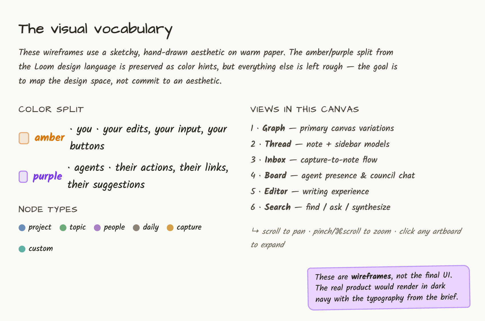
</p>

### Views

<table>
  <tr>
    <td align="center" width="50%">
      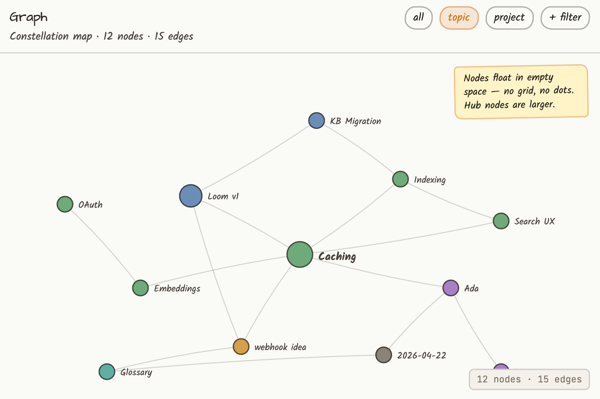<br />
      <sub><b>Graph</b> — constellation map with type-colored nodes, hub sizing, hover-highlighted neighborhoods</sub>
    </td>
    <td align="center" width="50%">
      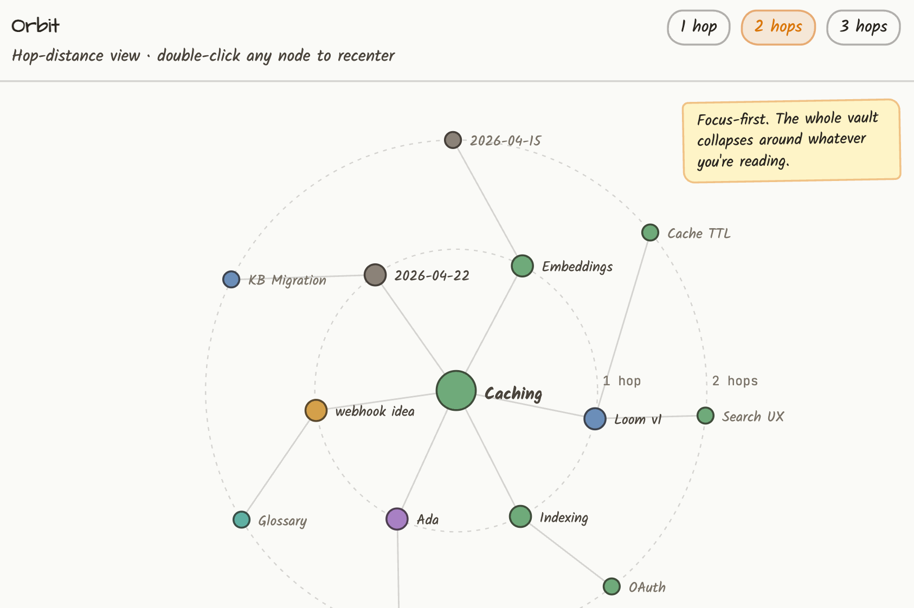<br />
      <sub><b>Orbit</b> — focus-first concentric rings around a selected note</sub>
    </td>
  </tr>
  <tr>
    <td align="center">
      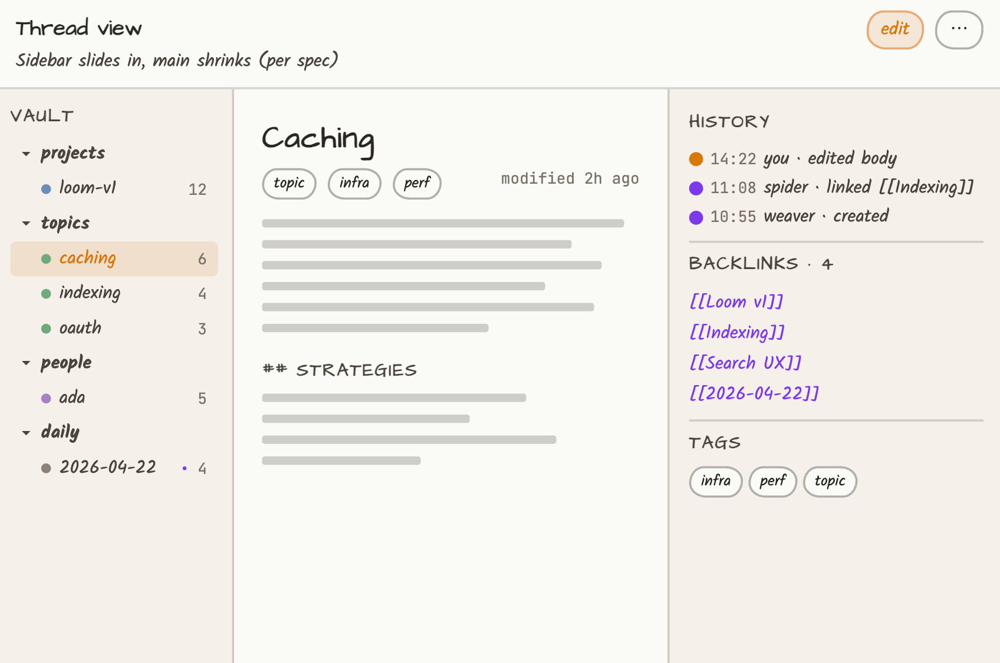<br />
      <sub><b>Thread</b> — serif-led note reader with edit history, backlinks, and local graph</sub>
    </td>
    <td align="center">
      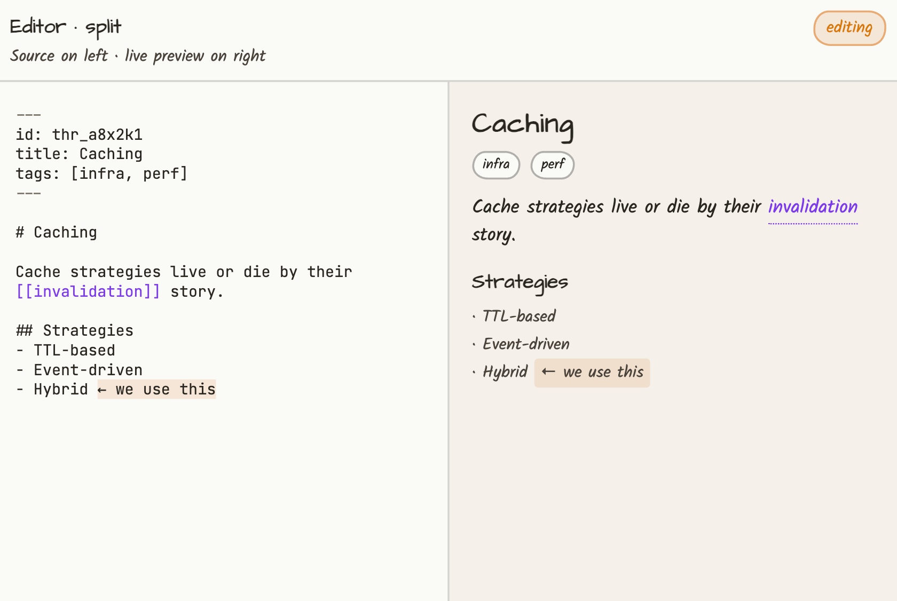<br />
      <sub><b>Editor</b> — split source/preview writing experience with wikilink autocomplete</sub>
    </td>
  </tr>
  <tr>
    <td align="center">
      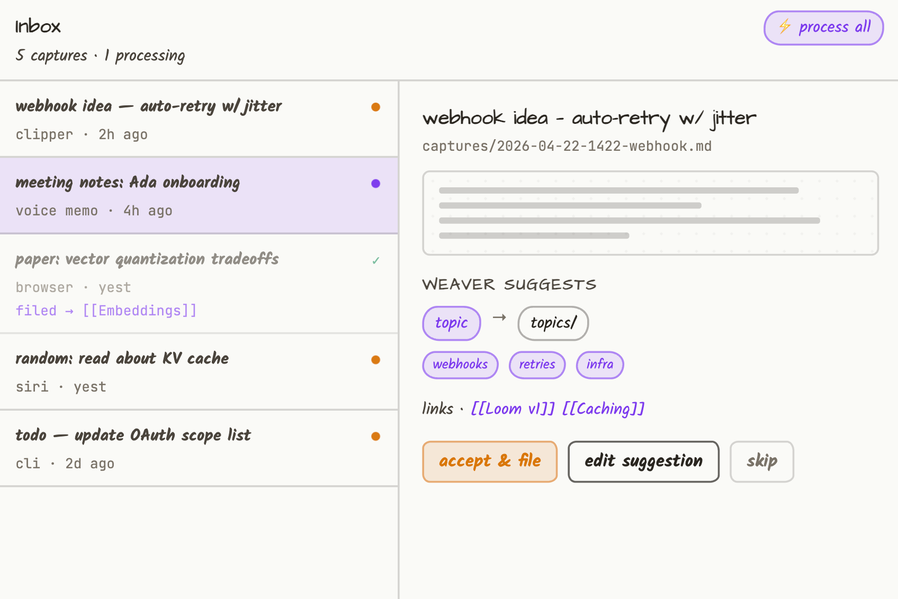<br />
      <sub><b>Inbox</b> — capture-to-note flow with Weaver suggestions for type, folder, tags, and links</sub>
    </td>
    <td align="center">
      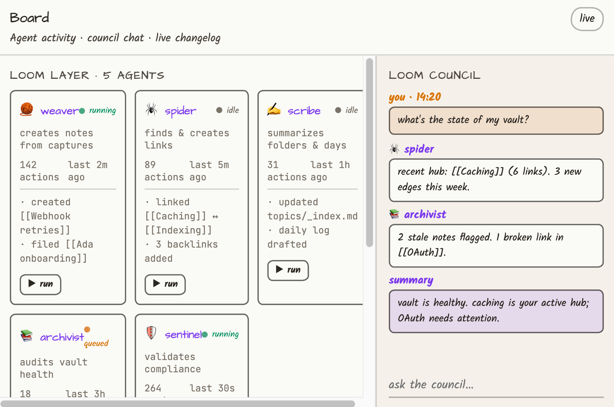<br />
      <sub><b>Board</b> — agent presence: cards and pulse modes with a live changelog</sub>
    </td>
  </tr>
  <tr>
    <td align="center">
      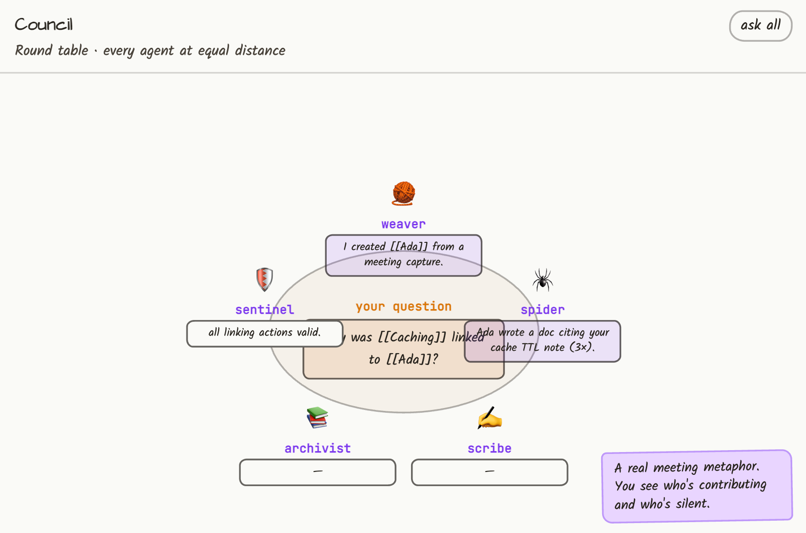<br />
      <sub><b>Council</b> — transparent multi-agent thread where all five Loom Layer agents answer together</sub>
    </td>
    <td align="center">
      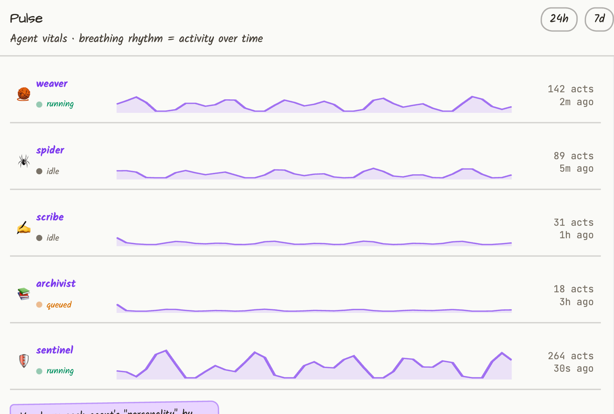<br />
      <sub><b>Pulse</b> — live ECG-style heartbeats showing each agent's running / queued / idle state</sub>
    </td>
  </tr>
  <tr>
    <td align="center" colspan="2">
      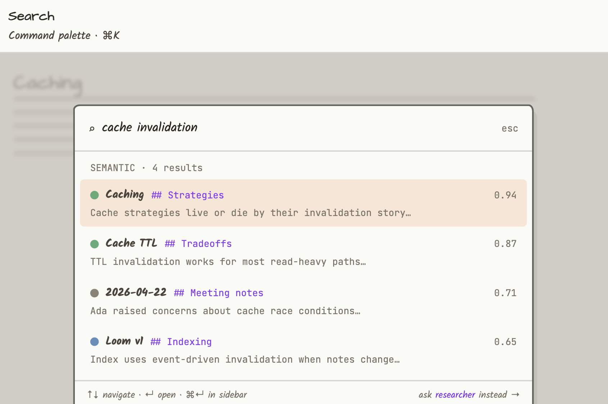<br />
      <sub><b>Search</b> — Cmd/Ctrl-K palette with hybrid semantic + keyword scoring across the vault</sub>
    </td>
  </tr>
</table>

## License

MIT — see [LICENSE](LICENSE).
