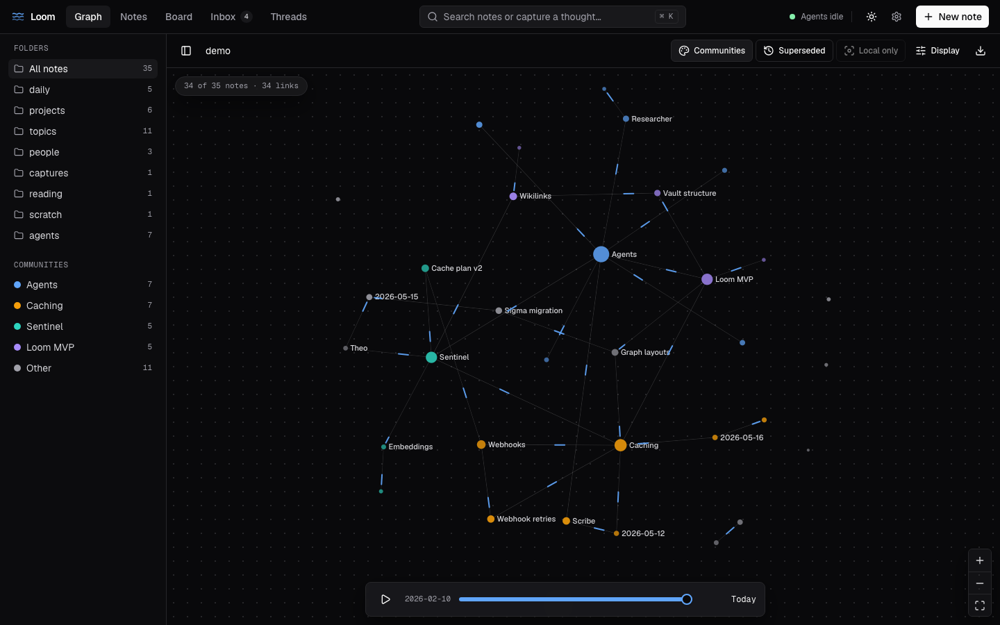
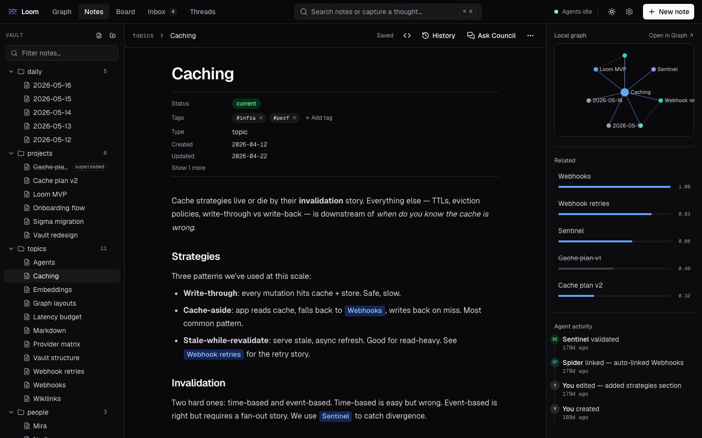
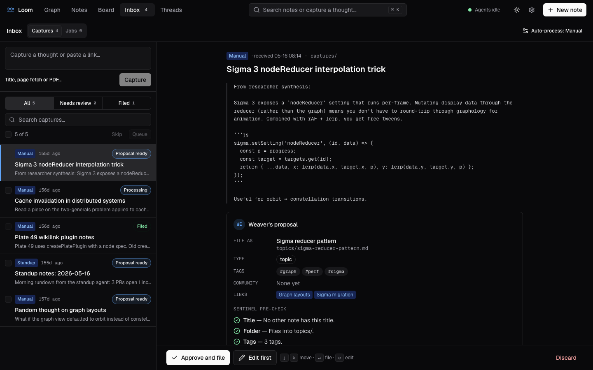
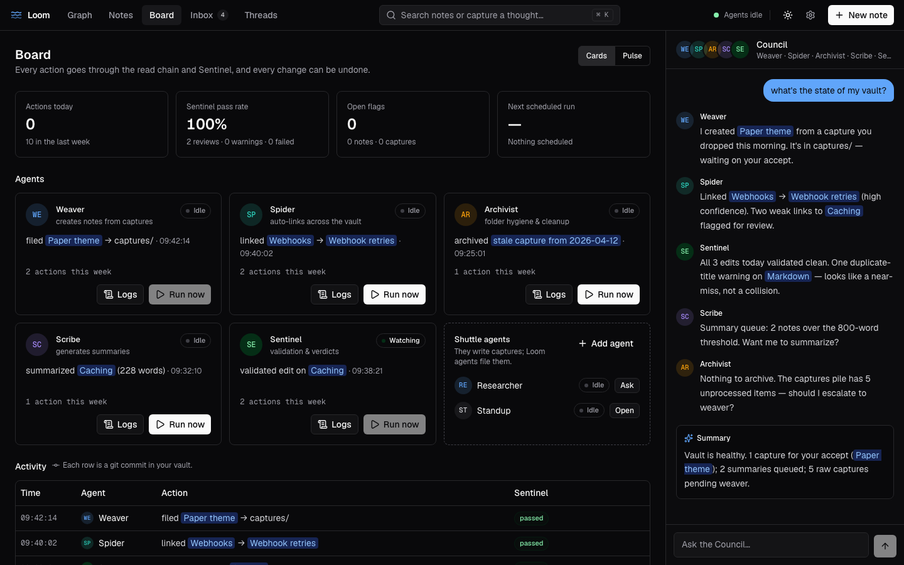
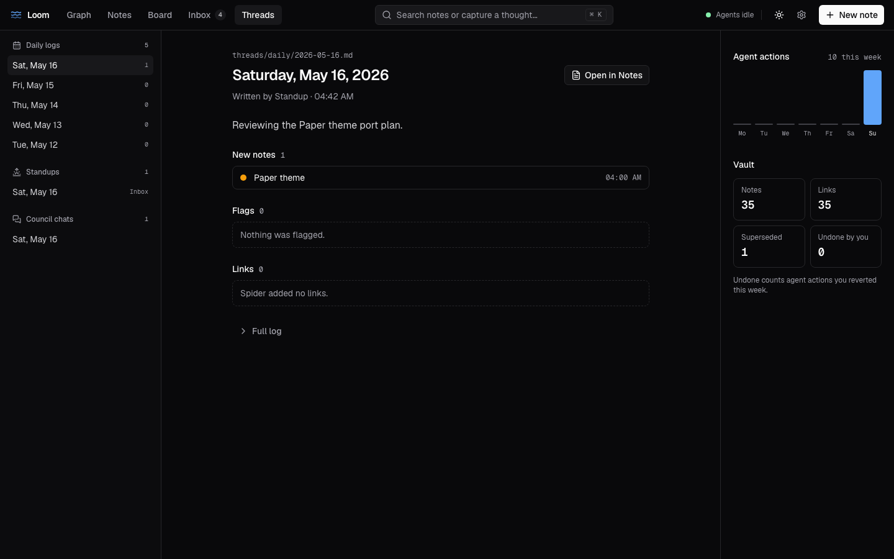
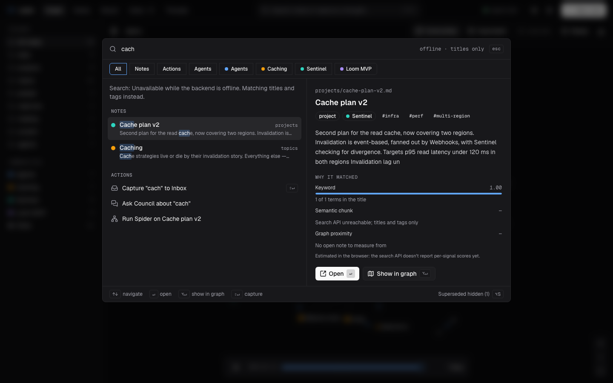
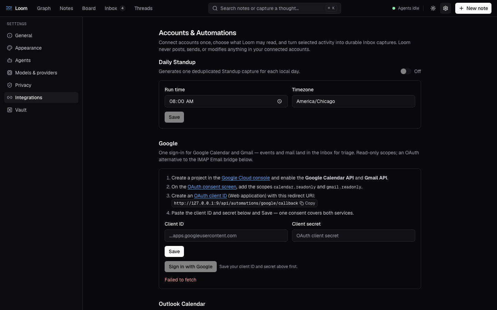

# Getting Started with Loom

Loom is a **local-first AI memory system**. Your notes live as plain Markdown
files on your own machine; a team of AI agents reads, links, and organizes them
on your behalf; and a knowledge graph lets you see how everything connects.
Nothing leaves your computer except the calls you make to your chosen AI
provider.

This guide takes you from zero to a working vault. For how Loom is *built*, see
[architecture-ref.md](architecture-ref.md); to contribute, see
[CONTRIBUTING.md](../CONTRIBUTING.md).

---

## 1. Install and run

The fastest path is Docker — one command builds the UI and API into a single
container.

```bash
cp .env.example .env     # optional — add a provider key now, or skip and use onboarding
docker compose up        # first build takes a few minutes
```

Then open **<http://localhost:8000>**.

> The container's port is bound to `127.0.0.1` (this machine only). Loom ships
> **no authentication** — don't expose it to a network without a reverse proxy +
> auth. See [SECURITY.md](../SECURITY.md).

Prefer to run from source? See the **Run from source** section in the
[README](../README.md#run-from-source-for-development).

---

## 2. First-run onboarding

On first launch a four-step wizard appears. You can re-run it any time from
**Settings → General → Re-run onboarding**.

1. **Welcome** — a quick orientation. Everything stays on this machine; you bring
   your own AI provider. Click **Begin →**.
2. **Pick a vault** — a vault is a folder that holds all your notes
   (`~/.loom/vaults/<name>`). Keep the default name to start. If a vault with
   that name already exists, you can **adopt** it (keep your notes), **reset** it
   (archive and start fresh), or pick a different name.
3. **Pick a look**: choose one of six themes. Graphite (dark) is the default;
   Paper and Linen are light, and Midnight, Forest and High contrast are dark.
   Each card previews its theme. Change it later in **Settings → Appearance**,
   where you can also follow your system's light/dark setting, pick an accent,
   switch the editor to a serif font, or use a colorblind-safe graph palette.
4. **Hook up AI providers** — pick where Loom's intelligence comes from (see
   below). You can **Skip for now** and add a provider later — but agents,
   search, and graph linking stay offline until you do.

> **Heads up:** provider API keys are encrypted at rest in `config.yaml`. The
> default Fernet master key lives at `~/.loom/.secret.key`; source installs can
> install `.[keychain]` and set `LOOM_SECRET_STORAGE=keyring` to migrate it into
> the OS credential store. This remains defense-in-depth, not API authentication.

### Choosing a provider

You can mix and match — your chat provider and your embedding provider can be
different. The **Finish** button unlocks once you've added a provider and a
successful **Test connection** for both chat and embeddings.

| Provider | API key? | Notes |
|----------|----------|-------|
| **Ollama (local)** | **No key** | Runs entirely on your machine — the free option. Install [Ollama](https://ollama.com), then `ollama pull llama3`. Host defaults to `http://localhost:11434`. |
| **OpenAI** | Yes | Defaults: chat `gpt-4o-mini`, embed `text-embedding-3-small`. |
| **Anthropic** | Yes | Defaults: chat `claude-sonnet-4-6`. Chat only. |
| **xAI** | Yes | Defaults: chat `grok-2-latest`. Chat only. |
| **OpenRouter** | Yes | One key, many models. Default chat `openai/gpt-4o-mini`. |

**No budget? Use Ollama** — it needs no key and runs locally. If you skip
providers entirely, Loom still opens and you can read/write notes by hand;
search falls back to keyword matching and the agents stay idle.

---

## 3. The big idea: capture → note → graph

Loom's core loop is **capture, then triage, then connect**:

1. **Something arrives as a capture** — a raw scrap in your Inbox. You create it
   yourself, an agent produces it, or you drop a `.md` file into
   `~/.loom/vaults/<name>/threads/captures/`.
2. **You triage it in the Inbox** — Loom's **Weaver** agent reads the capture and
   proposes how to file it (a type, a folder, a title, tags, and links to related
   notes). You accept, edit, or skip.
3. **It becomes a connected note** — once filed, **Spider** links it to related
   notes and **Sentinel** validates it. The note shows up in your graph, wired to
   its neighbors.

You don't have to use captures — you can also create finished notes directly
(below). But the capture flow is where Loom's agents earn their keep.

---

## 4. The main views

The header has five views: **Graph**, **Notes**, **Board**, **Inbox** and
**Threads**. Switch with a click or press **g** then **g**, **n**, **b**, **i**
or **t**. Search (**Cmd/Ctrl+K**), the agent status, a light/dark toggle,
Settings and **New note** sit on the right.

Use **Quick Capture** (**Cmd/Ctrl+Shift+C**) to save a thought or URL
immediately; it enters the same durable Inbox path as every other capture
source. For a URL, enable **Fetch page text and preserve the original** to
extract the page; otherwise Loom captures the link. Quick Capture also accepts
a PDF with embedded text. Imports preserve the original and provenance, are
limited to 8 MiB, and do not run OCR.

### Graph: see your knowledge

The home view: an interactive map of your vault. Nodes are notes and edges are
`[[wikilinks]]`. Notes are colored by **community**, the clusters your links
form, each named after its most-linked note.



- **Pan** by dragging, **zoom** by scrolling or with the +/− buttons, **F** to
  fit. Click a node to open the note beside the graph in a compact editor, with
  Archivist's warnings and its recent commits; **Open full editor** goes to
  Notes.
- The sidebar lists folders and communities; click either to filter.
  **Local only** shows just the selected note's neighbors, and **Superseded**
  shows or hides replaced notes.
- Scrub or play the **timeline** at the bottom to watch the vault grow by
  creation date.
- **Display** switches between the force layout and five orbit scenes, and
  tunes labels, sizes, depth and edge "travelers".
- **Export** the current view as PNG, SVG or JSON.
- Keyboard: arrow keys select nearby notes, **Enter** opens the full editor,
  **I** toggles Local only, **Esc** closes the note.

Empty vault? You'll see *"Your graph is empty. Capture a note to start
weaving."*

### Notes: read and edit

Opens when you pick a note in the graph, the vault tree, or search.



- The vault tree on the left creates notes and folders, moves notes by drag,
  and renames or archives from each row's menu.
- The editor is rich text, but Markdown stays the source of truth: blocks you
  don't touch are saved byte for byte. Toggle **raw Markdown** with the `<>`
  button. Type `[[` to link a note and `/` for the block menu.
- Above the text, **properties** show the note's status and tags. Spider's
  suggested links appear as cards you can accept or dismiss; a superseded note
  shows a banner pointing to its replacement.
- The rail on the right shows a local graph, related notes and recent agent
  activity.
- **History** opens git-backed diffs with undo, saved revisions, the original
  capture and link evidence. Unsaved drafts survive reloads, and a conflicting
  save keeps your text for compare, reload, or an explicit overwrite.
- **Archive** (from the ⋯ menu) moves the note to `threads/.archive/`. Loom
  never hard-deletes.

### Inbox: triage captures

Where raw captures become notes.



- The list shows each capture's source, age and status, with All / Needs
  review / Filed tabs, search, and bulk **Skip** or **Queue**. Type in the box
  at the top to capture something on the spot.
- Select a capture to see its content and **Weaver's proposal**: the file
  path, type, tags, community and the links Spider would add, plus Sentinel's
  pre-check.
- **Approve and file** files it, **Edit first** lets you change the proposal,
  and **Discard** archives the capture. A close match offers an explicit merge
  into the existing note instead.
- A failed validation keeps the source in the Inbox for retry or discard. The
  draft stays out of ordinary search and graph results until it's published.
- The **Jobs** tab is the durable processing ledger, and the header's
  **Auto-process** control decides which captures run without you.
- Keyboard: **j/k** to move, **e** to edit, **Enter** to approve.

### Board: watch (and run) the agents



- Stat cards show actions today, Sentinel's pass rate this week, open flags and
  the next scheduled run.
- Each **Loom agent** card (Weaver, Spider, Archivist, Scribe, Sentinel) shows
  its state (Running, Idle, Scheduled, Watching), last action and weekly count.
  **Logs** opens its instructions, recent runs and LLM calls; **Run now**
  triggers the agents that can run on their own.
- The **Shuttle agents** card opens the Researcher and Standup workspaces and
  your **custom agents**. **Add agent** defines one (name, icon, prompt, and an
  optional model); running it writes a capture to your Inbox.
- **Activity** lists recent agent actions with Sentinel's verdict. Each row is
  a git commit you can **Undo**: Loom previews every affected file and refuses
  to replace later edits.
- **Pulse** switches the agents to a live animated view.
- The right side hosts the **Loom Council** chat (below).

### Threads: what happened, day by day



- The list holds Scribe's **daily logs** (with how many notes each day made),
  **Standup** recaps, and saved **Council chats**.
- A daily log shows who wrote it, its summary, and that day's **new notes**,
  **flags** and **links**; the full log is one click away.
- The right side charts agent actions per day this week and counts your notes,
  links, superseded notes and the agent actions you undid.

### Automation and privacy

Settings' automation controls can pause background processing, set a daily
capture limit per source, and reserve an estimated daily input-token allowance.
Output tokens are counted after a response, so the allowance is not a hard
spending cap. Optional prices produce estimates, not provider invoices.
Folder/tag exclusions restrict automatic cloud context and embeddings. Raw
trace content is off by default; changing this setting does not erase older
traces that already contain content.

Revision history starts with writes made by this version. Keep normal vault
backups; revision and usage databases currently have no automatic pruning.

---

## 5. Creating notes directly

Press **Cmd/Ctrl+N** anywhere (or **New note** in the header) to create a note:
give it a title, pick a type (topic, project, person, daily, capture) and a
folder, add tags (Enter adds each one), and press **Create note** or
**Cmd/Ctrl+Enter**. Weaver files it through the read-before-write chain and
opens it in the editor, ready to type.

---

## 6. Searching

Press **Cmd/Ctrl+K** for the search palette. Type a query and Loom runs **hybrid
search** — semantic and keyword result ranks are combined with reciprocal-rank
fusion, then type/tag filters and graph context apply. It falls back to
keyword-only if you haven't configured an embedding provider.



- Results are grouped into **notes**, **actions** (capture the text, ask the
  Council, run Spider on a note) and **agents**. Chips narrow them to one kind
  or one community.
- The preview shows the note and **why it matched** (keyword, semantic and
  graph signals).
- **Arrow keys** move, **Enter** opens, **Alt+Enter** shows the note in the
  graph, **Shift+Enter** captures your text, and **Alt+S** includes superseded
  notes.

---

## 7. Talking to the Council

The **Loom Council** chat (on the Board view) lets you address all five Loom
agents at once. Ask about your vault ("what projects mention deployment?"),
request actions, or ask for a summary. The agents respond in a transparent,
streamed thread that ends in a **summary** card; each agent's answer sits
above it, and **raw call** links open the exact provider request and response,
so nothing is a black box. Past Council chats are kept in **Threads**.

For one-on-one work, the Shuttle agents (Researcher, Standup) have their own
1:1 chats.

---

## 8. Connecting read-only sources

Open **Settings → Integrations** to bring external context into the same durable
Inbox pipeline. Connections are opt-in and read-only:



- **Calendar feed** reads a private iCalendar URL for Standup context and
  idempotent event captures.
- **GitHub** polls selected repositories for commits, issues, and pull requests.
- **Email** polls an IMAP mailbox read-only with `BODY.PEEK`, so Loom does not
  mark messages as seen.
- **Google** uses one consent for read-only Calendar + Gmail and one encrypted,
  auto-refreshing token.
- **Outlook Calendar** uses delegated, read-only Microsoft Calendar access.

If whoever runs your Loom has set up its built-in apps
([docs/oauth-apps.md](oauth-apps.md)), Google, Outlook, and GitHub each connect
with one **Sign in with …** button. Otherwise each card walks you through
registering your own app in Google Cloud or Microsoft Entra (or pasting a GitHub
token), with the callback URL for the instance you are running.

---

## 9. Where your data lives

Everything is plain files under `~/.loom/`:

```
~/.loom/
├── config.yaml                  # global config + provider keys (encrypted at rest)
└── vaults/<name>/
    └── threads/
        ├── topics/  projects/  people/  daily/   # your notes, by type
        ├── captures/                              # the Inbox
        └── .archive/                              # archived ("deleted") notes
```

Notes are Markdown with YAML frontmatter and `[[wikilinks]]`. You can edit them
in any editor — Loom's file watcher picks up changes and re-indexes them. To back
up or move your knowledge, copy the folder.

### Try the demo vault

```bash
cp -r examples/demo-vault ~/.loom/vaults/demo
```

Then switch to it by re-running onboarding with `demo` as the vault name (or
`PUT /api/vaults/active` with `{"name": "demo"}`).

---

## Next steps

- **Contributing or running tests?** → [CONTRIBUTING.md](../CONTRIBUTING.md)
- **How it all works under the hood?** → [architecture-ref.md](architecture-ref.md)
- **Security & deployment boundaries?** → [SECURITY.md](../SECURITY.md)
